# GLUTN - Especialista en Pastas

## Trabajo Final Integrador - 2026

Aplicación móvil desarrollada como Trabajo Final Integrador de la Tecnicatura Universitaria en Programación de la Universidad Tecnológica Nacional - Facultad Regional Avellaneda.

El proyecto está orientado a la gestión integral de un restaurante, contemplando distintos perfiles de usuarios, registro y validación de clientes, asignación de mesas, gestión de pedidos, comunicación entre sectores, notificaciones y otras funcionalidades requeridas por la consigna.

---

# Índice

- 🔗 [Sobre el proyecto](https://github.com/Joadiaz02/GLUTN_Especialista_en_pastas-2026/blob/main/README.md#sobre-el-proyecto)
- 🔗 [Integrantes](https://github.com/Joadiaz02/GLUTN_Especialista_en_pastas-2026/blob/main/README.md#1-integrantes)
- 🔗 [Distribución actual de responsabilidades](https://github.com/Joadiaz02/GLUTN_Especialista_en_pastas-2026/blob/main/README.md#2-distribución-actual-de-responsabilidades)
- 🔗 [Cambios en la distribución de módulos](https://github.com/Joadiaz02/GLUTN_Especialista_en_pastas-2026/blob/main/README.md#cambios-en-la-distribución-de-módulos)
- 🔗 [Módulos y puntos funcionales](https://github.com/Joadiaz02/GLUTN_Especialista_en_pastas-2026/blob/main/README.md#3-módulos-y-puntos-funcionales)
  - 🔗 [Joaquín Díaz](https://github.com/Joadiaz02/GLUTN_Especialista_en_pastas-2026/blob/main/README.md#joaquín-felipe-díaz)
  - 🔗 [Javier Francisco Vilchez](https://github.com/Joadiaz02/GLUTN_Especialista_en_pastas-2026/blob/main/README.md#javier-francisco-vilchez)
  - 🔗 [Lucas Nicolás Ponte](https://github.com/Joadiaz02/GLUTN_Especialista_en_pastas-2026/blob/main/README.md#lucas-nicolás-ponte)
  - 🔗 [Mariano Pastor](https://github.com/Joadiaz02/GLUTN_Especialista_en_pastas-2026/blob/main/README.md#mariano-pastor)
- 🔗 [Tareas complementarias y extras](https://github.com/Joadiaz02/GLUTN_Especialista_en_pastas-2026/blob/main/README.md#tareas-complementarias-y-extras)
- 🔗 [Tecnologías y funcionalidades nativas](https://github.com/Joadiaz02/GLUTN_Especialista_en_pastas-2026/blob/main/README.md#tecnologías-y-funcionalidades-nativas)
- 🔗 [Cronología de avances](https://github.com/Joadiaz02/GLUTN_Especialista_en_pastas-2026/blob/main/README.md#cronología-de-avances)
- 🔗 [Códigos QR](https://github.com/Joadiaz02/GLUTN_Especialista_en_pastas-2026/blob/main/README.md#códigos-qr-del-restaurante)
- 🔗 [Capturas de la aplicación](https://github.com/Joadiaz02/GLUTN_Especialista_en_pastas-2026/blob/main/README.md#capturas-de-la-aplicación)
  - 🔗 [Logo del proyecto](https://github.com/Joadiaz02/GLUTN_Especialista_en_pastas-2026/blob/main/README.md#logo-del-proyecto)
  - 🔗 [Splash Screen](https://github.com/Joadiaz02/GLUTN_Especialista_en_pastas-2026/blob/main/README.md#splash-screen)
  - 🔗 [Login](https://github.com/Joadiaz02/GLUTN_Especialista_en_pastas-2026/blob/main/README.md#login)
  - 🔗 [Registro de clientes](https://github.com/Joadiaz02/GLUTN_Especialista_en_pastas-2026/blob/main/README.md#registro-de-clientes)
  - 🔗 [Registro de invitados](https://github.com/Joadiaz02/GLUTN_Especialista_en_pastas-2026/blob/main/README.md#registro-de-invitados)
  - 🔗 [Registro completado](https://github.com/Joadiaz02/GLUTN_Especialista_en_pastas-2026/blob/main/README.md#registro-completado)
  - 🔗 [Gestión de clientes](https://github.com/Joadiaz02/GLUTN_Especialista_en_pastas-2026/blob/main/README.md#gestión-de-clientes)
  - 🔗 [Rechazo de cliente](https://github.com/Joadiaz02/GLUTN_Especialista_en_pastas-2026/blob/main/README.md#rechazo-de-cliente)
  - 🔗 [Menú principal](https://github.com/Joadiaz02/GLUTN_Especialista_en_pastas-2026/blob/main/README.md#menú-principal)
  - 🔗 [Modales del menú principal](https://github.com/Joadiaz02/GLUTN_Especialista_en_pastas-2026/blob/main/README.md#modales-del-menú-principal)
  - 🔗 [Carta](https://github.com/Joadiaz02/GLUTN_Especialista_en_pastas-2026/blob/main/README.md#carta)
  - 🔗 [Platos](https://github.com/Joadiaz02/GLUTN_Especialista_en_pastas-2026/blob/main/README.md#platos)
  - 🔗 [Pedido](https://github.com/Joadiaz02/GLUTN_Especialista_en_pastas-2026/blob/main/README.md#pedido)
  - 🔗 [Acceso de personal](https://github.com/Joadiaz02/GLUTN_Especialista_en_pastas-2026/blob/main/README.md#acceso-de-personal)
  - 🔗 [Panel administrativo](https://github.com/Joadiaz02/GLUTN_Especialista_en_pastas-2026/blob/main/README.md#panel-administrativo)
  - 🔗 [Consultas al mozo](https://github.com/Joadiaz02/GLUTN_Especialista_en_pastas-2026/blob/main/README.md#consultas-al-mozo)
  - 🔗 [Administración de platos](https://github.com/Joadiaz02/GLUTN_Especialista_en_pastas-2026/blob/main/README.md#administración-de-platos)
  - 🔗 [Administración de bebidas](https://github.com/Joadiaz02/GLUTN_Especialista_en_pastas-2026/blob/main/README.md#administración-de-bebidas)
- 🔗 [Estructura de imágenes](https://github.com/Joadiaz02/GLUTN_Especialista_en_pastas-2026/blob/main/README.md#estructura-de-imágenes)

---

# Sobre el proyecto

La aplicación permite administrar diferentes perfiles de usuarios y cubrir el flujo principal de atención de un restaurante: ingreso de clientes, asignación de mesas, visualización de productos, realización y seguimiento de pedidos, comunicación con el personal, juegos, encuestas, solicitud de cuenta y liberación de mesas.

La organización de responsabilidades documentada en este README sigue la consigna del Trabajo Final Integrador, que solicita informar para cada integrante los módulos asignados, las fechas de inicio y finalización y la branch correspondiente.

---

# 1. Integrantes

- **Joaquín Felipe Díaz**
- **Javier Francisco Vilchez**
- **Lucas Nicolás Ponte**
- **Mariano Pastor**

---

# 2. Distribución actual de responsabilidades

La siguiente distribución corresponde al estado del proyecto luego de las modificaciones realizadas el **27/09/2026**.

| Integrante | Módulos asignados |
|---|---|
| **Joaquín Díaz** | 5, 6, 7, 8, **9 y 10 (en conjunto con Javier)**, 17 y 20 |
| **Javier Vilchez** | 1, 3, 4, **9 y 10 (en conjunto con Joaquín)**, 22 |
| **Lucas Ponte** | 11, 12, 13, 14, 19 y 21 |
| **Mariano Pastor** | 2, 15, 16 y 18 |

> **Nota:** Los puntos **9 y 10** son responsabilidad conjunta de **Joaquín Díaz y Javier Vilchez**. Se decidió trabajarlos en conjunto porque son módulos de mayor tamaño que integran varias funcionalidades relacionadas y requieren coordinación entre distintos flujos de la aplicación.

---

## Cambios en la distribución de módulos

### Actualización del 27/09/2026

El **27/09/2026** se realizó una modificación en la distribución de responsabilidades. Se decidió que los **puntos 9 y 10 fueran desarrollados en conjunto por Joaquín Díaz y Javier Vilchez**, ya que el equipo consideró que se trataba de módulos grandes, con varias funcionalidades y dependencias, por lo que resultaba más conveniente abordarlos entre dos integrantes en lugar de asignarlos a una sola persona.

### Intercambio de módulos entre Joaquín y Javier

También se realizó un intercambio de módulos entre **Joaquín Díaz y Javier Vilchez**:

- **Joaquín cedió el Punto 1 a Javier.**
- **Javier cedió el Punto 17 a Joaquín.**

El intercambio se realizó teniendo en cuenta la experiencia y la forma en que cada integrante podía abordar y resolver esas funcionalidades, buscando que cada módulo quedara a cargo del integrante que contaba con mayor familiaridad para desarrollarlo.


---

# 3. Módulos y puntos funcionales

Los puntos funcionales corresponden a las funcionalidades definidas en la consigna del Trabajo Final Integrador.

Los módulos se documentan individualmente indicando:

- Qué comprende cada módulo.
- Responsable.
- Fecha de inicio.
- Fecha de finalización, cuando corresponde.
- Estado.
- Branch correspondiente.

> **Criterio de documentación:** cuando no se dispone de una fecha de inicio o finalización en el registro actual del proyecto, se indica **"No informado"** en lugar de asumir una fecha.

---

## Joaquín Felipe Díaz

**Branch principal de trabajo:** `Joaquin-Diaz`

### Punto 5 - Crear un cliente registrado

**Qué se realiza:** registro de nuevos clientes mediante formulario, incluyendo datos personales, fotografía, lectura de QR del DNI, validaciones y estado inicial de pendiente de aprobación.

**Inicio:** 15/09/2026  
**Finalización:** 21/09/2026  
**Estado:** Finalizado  
**Branch:** `Joaquin-Diaz`

### Punto 6 - Verificar ingreso del cliente registrado

**Qué se realiza:** visualización de clientes pendientes de aprobación, recepción de la notificación correspondiente y posibilidad de aceptar o rechazar la solicitud.

**Inicio:** 15/09/2026  
**Finalización:** 21/09/2026  
**Estado:** Finalizado  
**Branch:** `Joaquin-Diaz`

### Punto 7 - Rechazar cliente registrado

**Qué se realiza:** rechazo de una solicitud de cliente, comunicación automática del estado mediante correo electrónico e impedimento de ingreso del cliente rechazado.

**Inicio:** 15/09/2026  
**Finalización:** 21/09/2026  
**Estado:** Finalizado  
**Branch:** `Joaquin-Diaz`

### Punto 8 - Aceptar cliente registrado

**Qué se realiza:** aprobación de clientes registrados y comunicación automática de la aceptación mediante correo electrónico, permitiendo posteriormente el ingreso del cliente.

**Inicio:** 15/09/2026  
**Finalización:** 21/09/2026  
**Estado:** Finalizado  
**Branch:** `Joaquin-Diaz`

### Punto 9 - Ingreso al local como cliente anónimo y lista de espera

**Qué se realiza:** registro de clientes anónimos, ingreso mediante QR del local, incorporación a la lista de espera, actualización del listado del metre, eliminación de clientes de la lista y restricciones de acceso hasta recibir una mesa.

**Responsables:** Joaquín Díaz + Javier Vilchez  
**Inicio:** No informado  
**Finalización:** No informada  
**Estado:** En construcción  
**Branches:** `Joaquin-Diaz` + `Javier-Vilchez`

> **Cambio:** desde el 27/09/2026 este módulo se desarrolla en conjunto debido a su tamaño y a la cantidad de funcionalidades que integra.

### Punto 10 - Asignación de mesa a un cliente

**Qué se realiza:** asignación de una mesa por parte del metre, notificación al cliente, lectura del QR de la mesa asignada y validación para impedir que el cliente se vincule con otra mesa o que la misma mesa sea asignada a otro cliente.

**Responsables:** Joaquín Díaz + Javier Vilchez  
**Inicio:** No informado  
**Finalización:** No informada  
**Estado:** En construcción  
**Branches:** `Joaquin-Diaz` + `Javier-Vilchez`

> **Cambio:** desde el 27/09/2026 este módulo se desarrolla en conjunto debido a su tamaño y a la cantidad de funcionalidades que integra.

### Punto 17 - Sector bar

**Qué se realiza:** recepción en el sector bar de los productos correspondientes a cada pedido, mostrando número de mesa, fecha, hora, productos y cantidades, agrupados para facilitar la gestión del cantinero.

**Inicio:** No informado  
**Finalización:** No informada  
**Estado:** No informado  
**Branch:** `Joaquin-Diaz`

### Punto 20 - Encuestas y gráficos

**Qué se realiza:** acceso del cliente a la encuesta de satisfacción, limitación a una encuesta por estadía y visualización de los resultados mediante distintos tipos de gráficos estadísticos.

**Inicio:** No informado  
**Finalización:** No informada  
**Estado:** No informado  
**Branch:** `Joaquin-Diaz`

---

## Javier Francisco Vilchez

**Branch principal de trabajo:** `Javier-Vilchez`

### Punto 1 - Agregar un empleado

**Qué se realiza:** alta de empleados por parte del dueño o supervisor, incluyendo datos personales, DNI/CUIL, correo, contraseña, perfil, fotografía tomada desde el dispositivo, lectura de QR del DNI y validación de todos los campos.

**Inicio:** No informado  
**Finalización:** No informada  
**Estado:** No informado  
**Branch:** `Javier-Vilchez`

> **Reasignación:** originalmente correspondía a Joaquín Díaz. El 27/09/2026 fue cedido a Javier como parte del intercambio de módulos.

### Punto 3 - Agregar una nueva bebida

**Qué se realiza:** alta y administración de bebidas con nombre, descripción, tiempo de elaboración, precio, fotografías, validaciones y verificación de existencia en la carta.

**Inicio:** 04/09/2026  
**Finalización:** 15/09/2026  
**Estado:** Finalizado  
**Branch:** `Javier-Vilchez`

### Punto 4 - Agregar una nueva mesa

**Qué se realiza:** creación y gestión de mesas con número, cantidad de comensales, tipo, disponibilidad, fotografía, QR automático y modificación de disponibilidad.

**Inicio:** 20/09/2026  
**Finalización:** 24/09/2026  
**Estado:** Finalizado  
**Branch:** `Javier-Vilchez`

### Punto 9 - Ingreso al local como cliente anónimo y lista de espera

**Qué se realiza:** registro de clientes anónimos, ingreso mediante QR del local, incorporación a la lista de espera, actualización del listado del metre, eliminación de clientes de la lista y restricciones de acceso hasta recibir una mesa.

**Responsables:** Joaquín Díaz + Javier Vilchez  
**Inicio:** No informado  
**Finalización:** No informada  
**Estado:** En construcción  
**Branches:** `Joaquin-Diaz` + `Javier-Vilchez`

### Punto 10 - Asignación de mesa a un cliente

**Qué se realiza:** asignación de una mesa por parte del metre, notificación al cliente, lectura del QR de la mesa asignada y validación para impedir que el cliente se vincule con otra mesa o que la misma mesa sea asignada a otro cliente.

**Responsables:** Joaquín Díaz + Javier Vilchez  
**Inicio:** No informado  
**Finalización:** No informada  
**Estado:** En construcción  
**Branches:** `Joaquin-Diaz` + `Javier-Vilchez`

### Punto 22 - Confirmación del pago y liberación de la mesa

**Qué se realiza:** confirmación del pago por parte del mozo, notificación al dueño y supervisor, liberación de la mesa y posterior verificación de disponibilidad. El punto también contempla la visualización de los resultados de las encuestas desde el QR correspondiente.

**Inicio:** No informado  
**Finalización:** No informada  
**Estado:** No informado  
**Branch:** `Javier-Vilchez`

---

## Lucas Nicolás Ponte

**Branch principal de trabajo:** `Lucas-ponte`

### Punto 11 - Visualización del menú y consulta al mozo

**Qué se realiza:** visualización del menú mediante el QR de la mesa y sistema de consultas al mozo, incluyendo sala de conversación y notificaciones para clientes y mozos.

**Inicio:** 07/09/2026  
**Finalización:** No informada  
**Estado:** En desarrollo  
**Branch:** `Lucas-ponte`

### Punto 12 - Realización del pedido

**Qué se realiza:** selección de productos y cantidades para los comensales, cálculo del importe acumulado, tiempo estimado de preparación, envío del pedido y seguimiento de su estado.

**Inicio:** 15/09/2026  
**Finalización:** 23/09/2026  
**Estado:** Finalizado  
**Branch:** `Lucas-ponte`

### Punto 13 - Rechazo del pedido

**Qué se realiza:** rechazo del pedido por parte del mozo para permitir que el cliente modifique, agregue o quite productos y vuelva a enviarlo.

**Inicio:** 15/09/2026  
**Finalización:** 23/09/2026  
**Estado:** Finalizado  
**Branch:** `Lucas-ponte`

### Punto 14 - Confirmación del pedido

**Qué se realiza:** confirmación del pedido por parte del mozo y derivación de los productos a los sectores correspondientes, además del seguimiento del estado y acceso a los juegos.

**Inicio:** 15/09/2026  
**Finalización:** 02/10/2026  
**Estado:** Finalizado  
**Branch:** `Lucas-ponte`

### Punto 19 - Entrega del pedido

**Qué se realiza:** entrega del pedido completo al cliente, confirmación de recepción y actualización del estado del pedido.

**Inicio:** No informado  
**Finalización:** No informada  
**Estado:** Aún no iniciado  
**Branch:** `Lucas-ponte`

### Punto 21 - Solicitud de la cuenta y pago

**Qué se realiza:** solicitud de la cuenta al mozo, selección de propina mediante QR, detalle de consumos, descuentos, propina y total, seguido del pago simulado y las notificaciones correspondientes.

**Inicio:** No informado  
**Finalización:** No informada  
**Estado:** No informado  
**Branch:** `Lucas-ponte`

---

## Mariano Pastor

**Branch principal de trabajo:** `Mariano-Pastor`

### Punto 2 - Agregar un nuevo plato

**Qué se realiza:** alta, baja, edición y listado de platos y postres, incluyendo buscador, descripción, tiempo de elaboración, precio, fotografías y validaciones.

**Inicio:** 11/09/2026  
**Finalización:** 22/09/2026  
**Estado:** Finalizado  
**Branch:** `Mariano-Pastor`

### Punto 15 - Juegos y descuentos

**Qué se realiza:** implementación de los juegos disponibles para los clientes y aplicación de descuentos obtenidos según las condiciones establecidas en la consigna.

**Inicio:** 13/09/2026  
**Finalización funcional:** 21/09/2026  
**Estado:** Finalizado funcionalmente  
**Branch:** `Mariano-Pastor`

### Punto 16 - Sector cocina

**Qué se realiza:** recepción en el sector cocina de los productos correspondientes al pedido, mostrando número de mesa, fecha, hora, productos y cantidades, agrupados por mesa.

**Inicio:** No informado  
**Finalización:** No informada  
**Estado:** Aún no iniciado  
**Branch:** `Mariano-Pastor`

### Punto 18 - Cocina y bar informan que el pedido está listo

**Qué se realiza:** comunicación de finalización de los productos por parte de cocina y bar, actualización del pedido y notificación al mozo cuando todos los sectores intervinientes finalizaron.

**Inicio:** No informado  
**Finalización:** No informada  
**Estado:** Aún no iniciado  
**Branch:** `Mariano-Pastor`

---

# 4. Tareas complementarias y extras

Además de los puntos funcionales principales, se desarrollaron tareas complementarias necesarias para la integración y el funcionamiento general de la aplicación.

## Correos electrónicos y notificaciones Push

**Responsable:** Joaquín Díaz

Implementación del sistema de comunicación para informar el estado de las solicitudes de clientes registrados.

Incluye:

- Envío de correo electrónico cuando un cliente se registra.
- Notificación del estado de la solicitud.
- Comunicación automática de aprobación.
- Comunicación automática de rechazo.
- Notificación Push a los usuarios correspondientes cuando existe un nuevo cliente pendiente de aprobación.
- Integración mediante Supabase Edge Functions.

**Inicio:** 21/09/2026  
**Finalización:** 23/09/2026  
**Estado:** Finalizado

## ↩️ Modales de volver y cerrar sesión

**Responsable:** Lucas Ponte

Desarrollo de modales reutilizables para confirmar:

- Volver.
- Cerrar sesión.

**Inicio:** 05/09/2026  
**Finalización:** 15/09/2026  
**Estado:** Finalizado

## 💬 Chat / Consulta al mozo

Implementación del sistema de consulta entre cliente y mozo como parte del Punto 11.

**Inicio:** 07/09/2026  
**Finalización:** No informada  
**Estado:** En desarrollo

## 🏠 Home / Menú principal

Desarrollo del menú principal de la aplicación, incluyendo los accesos a las diferentes funcionalidades disponibles para el cliente.

**Inicio:** 24/08/2026  
**Finalización:** No informada  
**Estado:** En desarrollo

## 📷 Escáner QR del Home

Implementación del escáner QR desde el menú principal para funcionalidades relacionadas con:

- Ingreso.
- Mesa.
- Propinas.

**Inicio:** 23/09/2026  
**Finalización:** No informada  
**Estado:** En desarrollo

> La implementación completa depende de funcionalidades relacionadas con la lista de espera, asignación de mesas y propinas.

## 🍝 Carta conectada a datos

Integración de la carta con los datos de los productos.

**Inicio:** 12/09/2026  
**Finalización:** 18/09/2026  
**Estado:** Finalizado

## 📅 Reservas

Implementación de la interfaz visual correspondiente al módulo de reservas.

**Inicio:** 14/09/2026  
**Finalización:** 18/09/2026  
**Estado:** Finalizado

> La implementación de la lógica restante depende de las funcionalidades correspondientes a las etapas posteriores del proyecto.

## ⏳ Spinner con logo y feedback compartido

Implementación de un sistema reutilizable de espera y feedback para la aplicación, incluyendo:

- Spinner con logo.
- Vibración.
- Sonidos.

**Inicio:** 11/09/2026  
**Finalización:** 12/09/2026  
**Estado:** Finalizado

## 🟢 Logo unificado y optimizado

Optimización y unificación del logo utilizado en las distintas secciones de la aplicación.

**Inicio:** 18/09/2026  
**Finalización:** 22/09/2026  
**Estado:** Finalizado

## 🧭 Header reutilizable

Implementación de un header reutilizable para las distintas pantallas de la aplicación.

Incluye:

- Botón volver.
- Botón cerrar sesión.
- Confirmación de acciones.

**Inicio:** 23/09/2026  
**Finalización:** 24/09/2026  
**Estado:** Finalizado

## 📱 Ícono y Splash de la aplicación

Actualización del ícono y Splash Screen de la aplicación utilizando la identidad visual en verde.

**Inicio:** 24/09/2026  
**Finalización:** 24/09/2026  
**Estado:** Finalizado

---

# 5. 🛠️ Tecnologías y funcionalidades nativas

El proyecto fue desarrollado utilizando:

- Ionic
- Angular
- Capacitor
- Supabase
- SCSS
- HTML
- TypeScript

Además, se utilizan funcionalidades nativas de los dispositivos móviles, como:

- 📷 Cámara.
- 📱 Vibración háptica.
- 🔊 Reproducción de sonidos.
- 🔔 Notificaciones Push.
- 📲 Escaneo y lectura de códigos QR.
- 💾 Almacenamiento local.
- 🌐 Comunicación con Supabase.
- 🔐 Autenticación de usuarios.
- ☁️ Almacenamiento de imágenes.
- 📧 Envío de correos electrónicos mediante Gmail API.

---

# 6. 📊 Cronología de avances

| Tarea | Responsable | Inicio | Finalización | Estado |
|---|---|---:|---:|---|
| Logo | Mariano Pastor | 23/08/2026 | 24/08/2026 | Realizado |
| Splash Screen | Joaquín Díaz | 23/08/2026 | 24/08/2026 | Realizado |
| Registro de usuarios | Javier Vilchez | 24/08/2026 | 28/08/2026 | Realizado |
| Login de usuarios registrados y personal | Lucas Ponte | 25/08/2026 | 03/09/2026 | Realizado |
| Menú principal | Mariano Pastor | 24/08/2026 | — | En desarrollo |
| Panel administrativo | Joaquín Díaz | 01/09/2026 | 03/09/2026 | Realizado |
| Modales volver/cerrar sesión | Lucas Ponte | 05/09/2026 | 15/09/2026 | Realizado |
| Chat / consulta al mozo | Mariano Pastor | 07/09/2026 | — | En desarrollo |
| Spinner, vibración y sonido | Mariano Pastor | 11/09/2026 | 12/09/2026 | Realizado |
| Administración de platos y postres | Mariano Pastor | 11/09/2026 | 22/09/2026 | Realizado |
| Carta conectada a datos | Mariano Pastor | 12/09/2026 | 18/09/2026 | Realizado |
| Juegos | Mariano Pastor | 13/09/2026 | 21/09/2026 | Realizado |
| Reservas - interfaz | Mariano Pastor | 14/09/2026 | 18/09/2026 | Realizado |
| Puntos 5, 6, 7 y 8 - Clientes registrados | Joaquín Díaz | 15/09/2026 | 21/09/2026 | Realizado |
| Administración de bebidas | Javier Vilchez | 04/09/2026 | 15/09/2026 | Realizado |
| Realización del pedido | Lucas Ponte | 15/09/2026 | 23/09/2026 | Realizado |
| Rechazo del pedido | Lucas Ponte | 15/09/2026 | 23/09/2026 | Realizado |
| Correos y Push - clientes pendientes | Joaquín Díaz | 21/09/2026 | 23/09/2026 | Realizado |
| Logo unificado | Mariano Pastor | 18/09/2026 | 22/09/2026 | Realizado |
| Escáner QR del Home | Javier Vilchez | 23/09/2026 | — | En desarrollo |
| Header reutilizable | Lucas Ponte | 23/09/2026 | 24/09/2026 | Realizado |
| Administración de mesas | Javier Vilchez | 20/09/2026 | 24/09/2026 | Realizado |
| Ícono y Splash en verde | Mariano Pastor | 24/09/2026 | 24/09/2026 | Realizado |
| Confirmación del pedido | Lucas Ponte | 15/09/2026 | 02/10/2026 | Realizado |

---
---

## Códigos QR del restaurante

La aplicación utiliza códigos QR para permitir el ingreso de los clientes y asociarlos a una mesa determinada.

### QR de ingreso

QR utilizado para el ingreso general de los clientes al restaurante.

<p align="center">
  
</p>

---

### QR Mesa 1

QR correspondiente a la Mesa 1.

<p align="center">
  
</p>

---

### QR Mesa 2

QR correspondiente a la Mesa 2.

<p align="center">
  
</p>

---

### QR Mesa 3

QR correspondiente a la Mesa 3.

<p align="center">
  
</p>

---

### QR Mesa 4

QR correspondiente a la Mesa 4.

<p align="center">
  
</p>

---

### QR Mesa 5

QR correspondiente a la Mesa 5.

<p align="center">
  
</p>

---


# 📸 Capturas de la aplicación

## Logo del proyecto

<p align="center">
  
</p>

---

## Splash Screen

<p align="center">
  
</p>

---

## Login

<p align="center">
  
</p>

---

## Registro de clientes

<p align="center">
  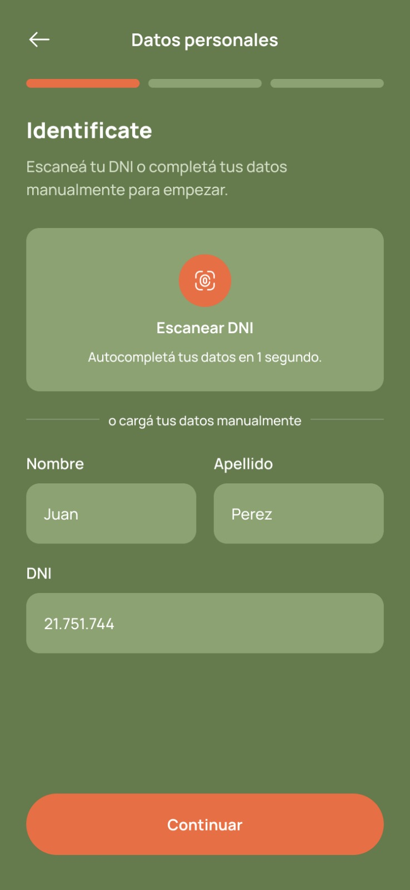
</p>

<p align="center">
  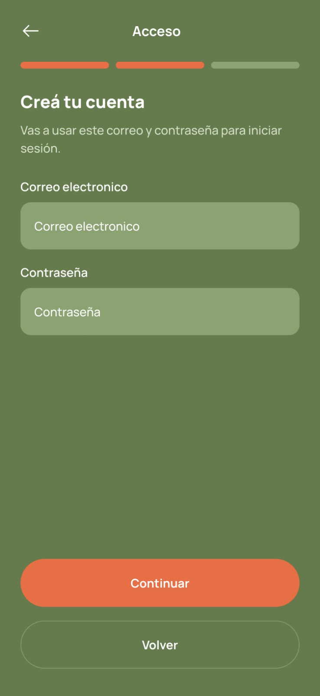
</p>

<p align="center">
  
</p>

---

## Registro de invitados

<p align="center">
  
</p>

<p align="center">
  
</p>

---

## Registro completado

<p align="center">
  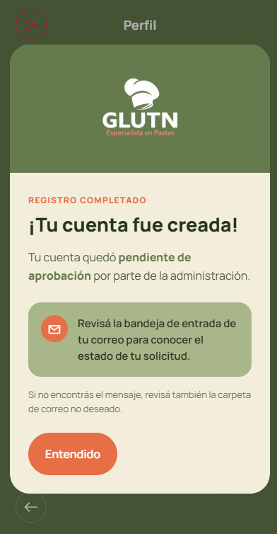
</p>

---

## Gestión de clientes

<p align="center">
  
</p>

---

## Rechazo de cliente

<p align="center">
  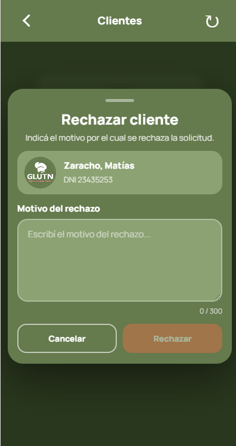
</p>

---

## Menú principal

<p align="center">
  
</p>

---

## Modales del menú principal

### Quiénes somos

<p align="center">
  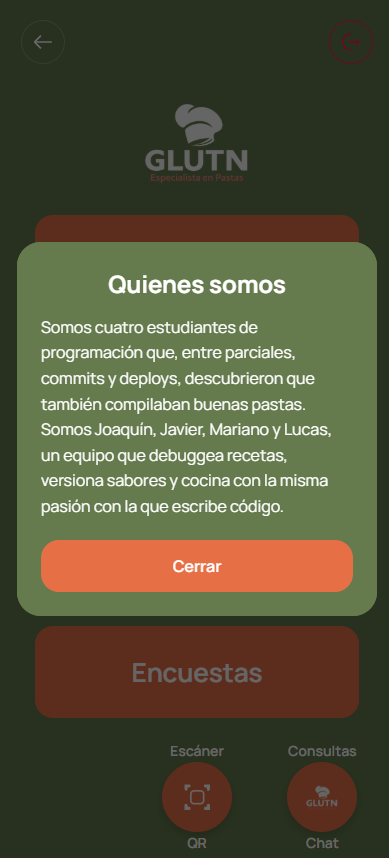
</p>

### Productos destacados

<p align="center">
  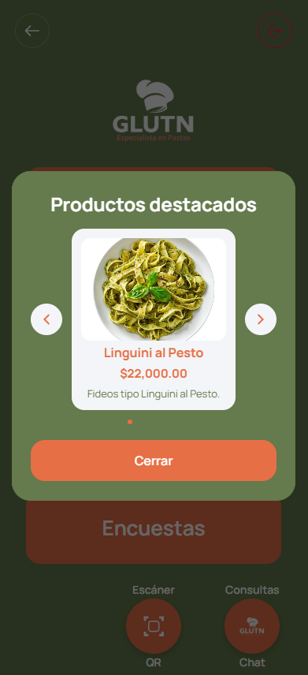
</p>

---

## Carta

<p align="center">
  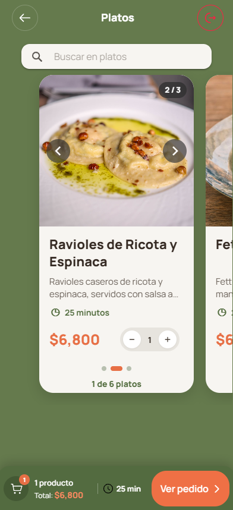
</p>

---

## Platos

<p align="center">
  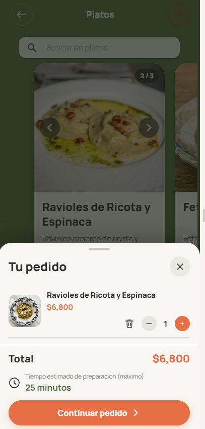
</p>

---

## Pedido

### Resumen del pedido

<p align="center">
  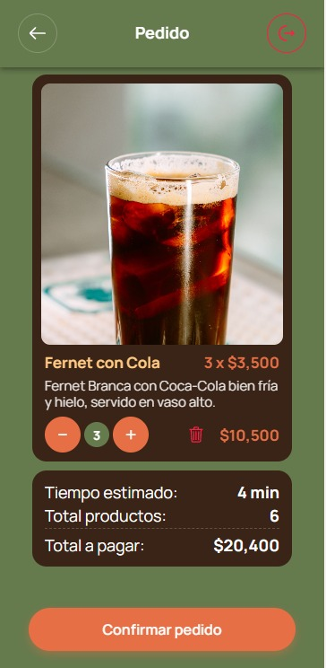
</p>

### Confirmación del pedido

<p align="center">
  
</p>

---

## Acceso de personal

<p align="center">
  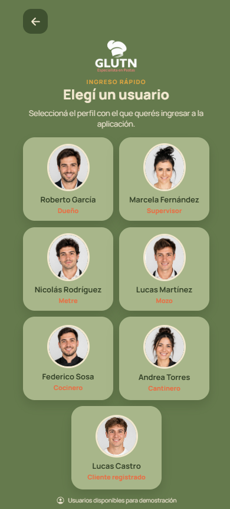
</p>

---

## Panel administrativo

<p align="center">
  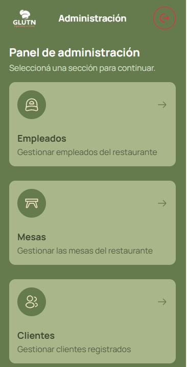
</p>

---

## Consultas al mozo

<p align="center">
  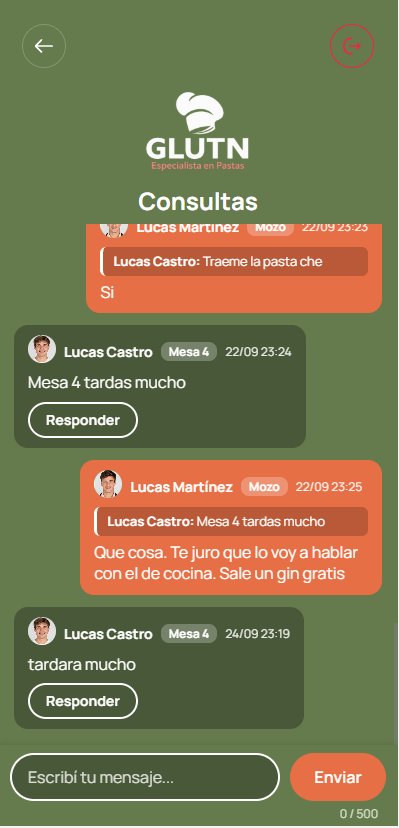
</p>

---

## Administración de platos

<p align="center">
  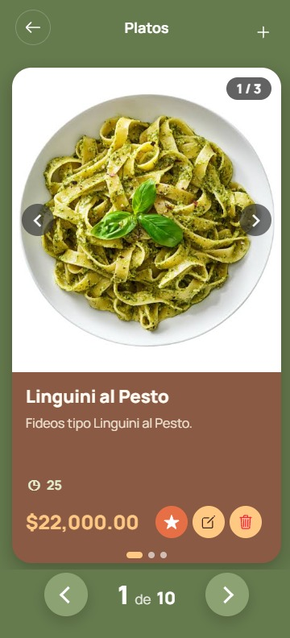
</p>

---

## Administración de bebidas

<p align="center">
  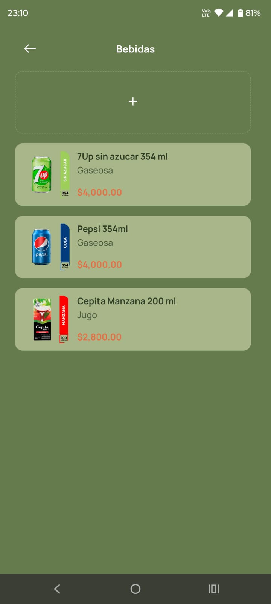
</p>

<p align="center">
  
</p>

<p align="center">
  
</p>

<p align="center">
  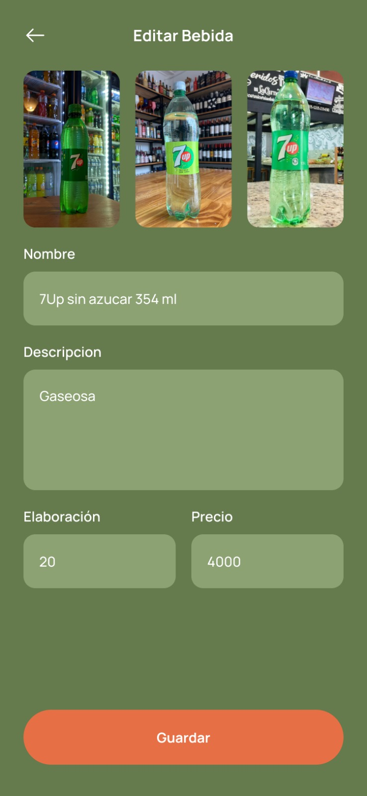
</p>

---

# 10. 🗂️ Estructura de imágenes

Las capturas utilizadas en este README se encuentran dentro de la carpeta:

```text
images/


---
