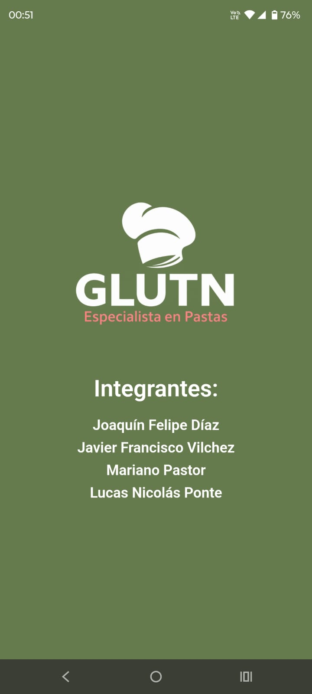
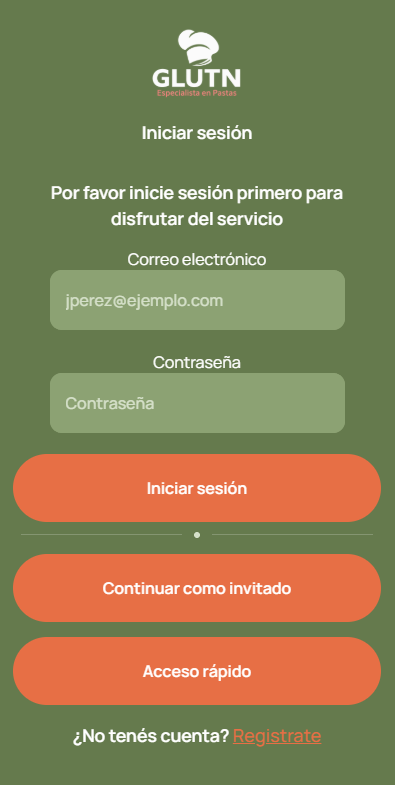
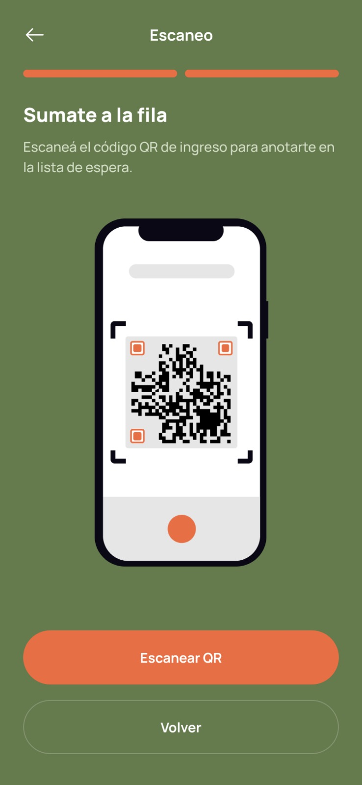
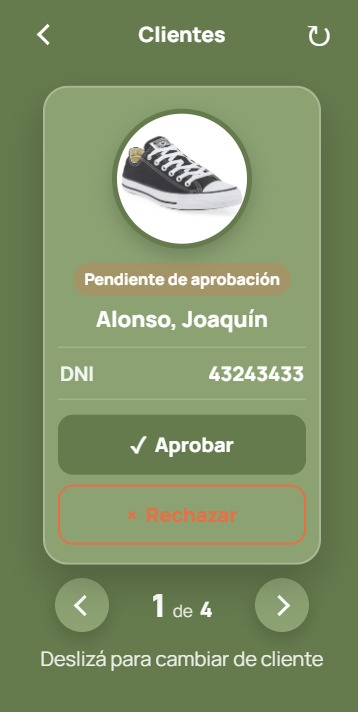
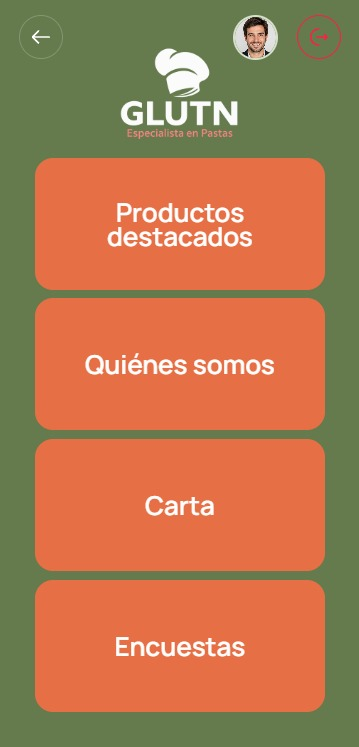
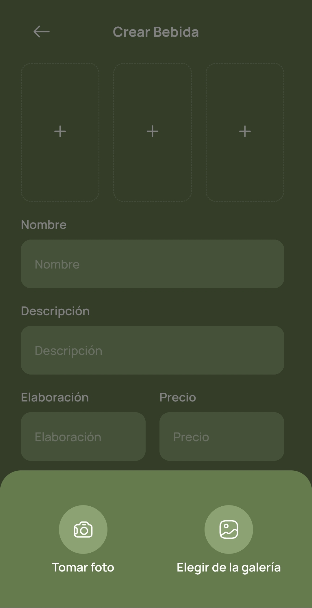

# GLUTN - Especialista en Pastas

## Trabajo Final Integrador - 2026

## 🖼️ Logo del proyecto

<p align="center">
  
</p>

---

# 📸 Capturas de la aplicación

## Splash Screen

<p align="center">
  
</p>

---

## Login

<p align="center">
  
</p>

---

## Registro de clientes

<p align="center">
  
</p>

<p align="center">
  
</p>

<p align="center">
  
</p>

---

## Registro de invitados

<p align="center">
  
</p>

<p align="center">
  
</p>

---

## Registro completado

<p align="center">
  
</p>

---

## Gestión de clientes

<p align="center">
  
</p>

---

## Rechazo de cliente

<p align="center">
  
</p>

---

## Menú principal

<p align="center">
  
</p>

---

## Modales del menú principal

### Quiénes somos

<p align="center">
  
</p>

### Productos destacados

<p align="center">
  
</p>

---

## Carta

<p align="center">
  
</p>

---

## Platos

<p align="center">
  
</p>

---

## Pedido

### Resumen del pedido

<p align="center">
  
</p>

### Confirmación del pedido

<p align="center">
  
</p>

---

## Acceso de personal

<p align="center">
  
</p>

---

## Panel administrativo

<p align="center">
  
</p>

---

## Consultas al mozo

<p align="center">
  
</p>

---

## Administración de platos

<p align="center">
  
</p>

---

## Administración de bebidas

<p align="center">
  
</p>

<p align="center">
  
</p>

<p align="center">
  
</p>

<p align="center">
  
</p>

---

# 📱 Sobre el proyecto

Aplicación móvil desarrollada como Trabajo Final Integrador de la Tecnicatura Universitaria en Programación de la Universidad Tecnológica Nacional - Facultad Regional Avellaneda.

La aplicación está orientada a la gestión integral de un restaurante, permitiendo administrar diferentes perfiles de usuarios, el ingreso de clientes, la asignación de mesas, la gestión de pedidos y la comunicación entre los distintos sectores del restaurante.

---

# 1. 👥 Integrantes

- **Joaquín Felipe Díaz**
- **Javier Francisco Vilchez**
- **Lucas Nicolás Ponte**
- **Mariano Pastor**

---

# 2. 🛠️ Stack tecnológico utilizado

El proyecto fue desarrollado utilizando:

- Ionic
- Angular
- Capacitor
- Supabase
- SCSS
- HTML
- TypeScript

Además, se utilizan funcionalidades nativas de los dispositivos móviles, como:

- Cámara
- Escaneo de códigos
- Vibraciones
- Sonidos
- Notificaciones Push
- Lectura de códigos QR

---

# 3. 📱 Módulos y puntos funcionales

Los siguientes puntos corresponden a las funcionalidades principales establecidas para el Trabajo Final Integrador.

---

## 👤 Joaquín Díaz

### Punto 1 - Agregar empleado

Gestión de empleados y perfiles dentro de la aplicación.

---

### Punto 5 - Crear cliente registrado

Implementación del registro de nuevos clientes mediante el formulario correspondiente.

**Inicio:** 15/09/2026  
**Finalización:** 21/09/2026.

---

### Punto 6 - Verificar ingreso del cliente registrado

Implementación de la verificación del estado de aprobación de los clientes registrados antes de permitir su ingreso a la aplicación.

**Inicio:** 15/09/2026  
**Finalización:** 21/09/2026.

---

### Punto 7 - Rechazar cliente registrado

Implementación de la gestión de rechazo de solicitudes de clientes registrados, incluyendo el ingreso del motivo correspondiente.

**Inicio:** 15/09/2026  
**Finalización:** 21/09/2026.

---

### Punto 8 - Aceptar cliente registrado

Implementación de la aprobación de solicitudes de clientes registrados.

**Inicio:** 15/09/2026  
**Finalización:** 21/09/2026.

---

### Punto 20 - Encuestas y gráficos

Implementación del módulo de encuestas y visualización de resultados.

---

## 👤 Javier Vilchez

### Punto 3 - Agregar bebida

Módulo de administración de bebidas.

**Finalizado:** 15/09/2026.

---

### Punto 4 - Agregar mesa

Módulo de creación y administración de mesas.

**Finalizado:** 24/09/2026.

---

### Punto 9 - Ingreso de cliente anónimo y lista de espera

Funcionalidad correspondiente al ingreso de clientes anónimos y gestión de la lista de espera.

**Estado:** En construcción.

---

## 👤 Lucas Ponte

### Punto 11 - Visualización del menú y consulta al mozo

Implementación de la comunicación entre el cliente y el mozo mediante consultas.

**Estado:** En desarrollo.

---

### Punto 12 - Realización del pedido

Implementación del flujo de realización y gestión de pedidos.

**Inicio:** 15/09/2026  
**Finalización:** 23/09/2026.

---

### Punto 13 - Rechazo del pedido

Implementación del flujo de rechazo de pedidos.

**Inicio:** 15/09/2026  
**Finalización:** 23/09/2026.

---

## 👤 Mariano Pastor

### Punto 2 - Agregar nuevo plato

Módulo de administración de platos y postres, incluyendo:

- Alta de platos.
- Baja de platos.
- Edición de platos.
- Listado de platos.
- Buscador.

**Inicio:** 11/09/2026  
**Finalización:** 22/09/2026.

---

### Punto 15 - Juegos

Implementación de los juegos disponibles para los clientes:

- Ruleta.
- Sopa de letras.
- Ta-Te-Ti.
- Descuentos.

**Inicio:** 13/09/2026  
**Finalización funcional:** 21/09/2026.

---

### Punto 16 - Sector cocina

Funcionalidad correspondiente a la recepción de productos por parte del sector cocina.

**Estado:** Aún no iniciado.

---

### Punto 18 - Cocina y bar informan que el pedido está listo

Funcionalidad correspondiente a la notificación de productos terminados.

**Estado:** Aún no iniciado.

---

### Punto 19 - Entrega del pedido

Funcionalidad correspondiente a la entrega del pedido al cliente.

**Estado:** Aún no iniciado.

---

# 4. 📧 Correos electrónicos y notificaciones Push

## Notificaciones de clientes pendientes

Implementación del sistema de comunicación para informar el estado de las solicitudes de clientes registrados.

El sistema contempla:

- Envío de correo electrónico cuando un cliente se registra.
- Notificación del estado de la solicitud.
- Comunicación de aprobación de la cuenta.
- Comunicación de rechazo de la cuenta.
- Notificación Push a los usuarios correspondientes cuando existe un nuevo cliente pendiente de aprobación.

**Inicio:** 21/09/2026  
**Finalización:** 23/09/2026.

La implementación utiliza Supabase Edge Functions para centralizar el envío de correos electrónicos y notificaciones Push.

---

# 5. 🔧 Otras tareas realizadas

Además de los puntos funcionales principales, se desarrollaron tareas complementarias necesarias para la integración y funcionamiento de la aplicación.

---

## Modales de volver y cerrar sesión

Desarrollo de modales reutilizables para confirmar:

- Volver.
- Cerrar sesión.

**Responsable:** Lucas Ponte  
**Inicio:** 05/09/2026  
**Finalización:** 15/09/2026.

---

## Chat / Consulta al mozo

Implementación del sistema de consulta entre el cliente y el mozo como parte del Punto 11.

**Inicio:** 07/09/2026  
**Estado:** En desarrollo.

---

## Home / Menú principal

Desarrollo del menú principal de la aplicación, incluyendo los accesos a las diferentes funcionalidades disponibles para el cliente.

**Inicio:** 24/08/2026  
**Estado:** En desarrollo.

---

## Escáner QR del Home

Implementación del escáner QR desde el menú principal para funcionalidades relacionadas con:

- Ingreso.
- Mesa.
- Propinas.

**Inicio:** 23/09/2026  
**Estado:** En desarrollo.

> La implementación completa depende de funcionalidades relacionadas con la lista de espera, asignación de mesas y propinas.

---

## Carta conectada a datos

Integración de la carta con los datos de los productos.

**Inicio:** 12/09/2026  
**Finalización:** 18/09/2026.

---

## Reservas

Implementación de la interfaz visual correspondiente al módulo de reservas.

**Inicio:** 14/09/2026  
**Finalización:** 18/09/2026.

> La implementación de la lógica restante del módulo corresponde a las funcionalidades pendientes del proyecto.

---

## Spinner con logo y feedback compartido

Implementación de un sistema reutilizable de espera y feedback para la aplicación, incluyendo:

- Spinner con logo.
- Vibración.
- Sonidos.

**Inicio:** 11/09/2026  
**Finalización:** 12/09/2026.

---

## Logo unificado y optimizado

Optimización y unificación del logo utilizado en las distintas secciones de la aplicación.

**Inicio:** 18/09/2026  
**Finalización:** 22/09/2026.

---

## Header reutilizable

Implementación de un header reutilizable para las distintas pantallas de la aplicación.

Incluye:

- Botón volver.
- Botón cerrar sesión.
- Confirmación de acciones.

**Inicio:** 23/09/2026  
**Finalización:** 24/09/2026.

---

## Ícono y Splash de la aplicación

Actualización del ícono y Splash Screen de la aplicación utilizando la identidad visual en verde.

**Inicio:** 24/09/2026  
**Finalización:** 24/09/2026.

---

# 6. 📊 Cronología de avances

| Tarea | Responsable | Inicio | Finalización | Estado |
|---|---|---:|---:|---|
| Logo | Mariano Pastor | 23/08/2026 | 24/08/2026 | Realizado |
| Splash Screen | Joaquín Díaz | 23/08/2026 | 24/08/2026 | Realizado |
| Registro de usuarios | Javier Vilchez | 24/08/2026 | 28/08/2026 | Realizado |
| Login de usuarios registrados y personal | Lucas Ponte | 25/08/2026 | 03/09/2026 | Realizado |
| Menú principal | Mariano Pastor | 24/08/2026 | — | En desarrollo |
| Panel administrativo | Joaquín Díaz | 01/09/2026 | 03/09/2026 | Realizado |
| Modales volver/cerrar sesión | Lucas Ponte | 05/09/2026 | 15/09/2026 | Realizado |
| Chat / consulta al mozo | Mariano Pastor | 07/09/2026 | — | En desarrollo |
| Spinner, vibración y sonido | Mariano Pastor | 11/09/2026 | 12/09/2026 | Realizado |
| Administración de platos y postres | Mariano Pastor | 11/09/2026 | 22/09/2026 | Realizado |
| Carta conectada a datos | Mariano Pastor | 12/09/2026 | 18/09/2026 | Realizado |
| Juegos | Mariano Pastor | 13/09/2026 | 21/09/2026 | Realizado |
| Reservas - interfaz | Mariano Pastor | 14/09/2026 | 18/09/2026 | Realizado |
| Puntos 5, 6, 7 y 8 - Clientes registrados | Joaquín Díaz | 15/09/2026 | 21/09/2026 | Realizado |
| Administración de bebidas | Javier Vilchez | 04/09/2026 | 15/09/2026 | Realizado |
| Realización del pedido | Lucas Ponte | 15/09/2026 | 23/09/2026 | Realizado |
| Rechazo del pedido | Lucas Ponte | 15/09/2026 | 23/09/2026 | Realizado |
| Correos y Push - clientes pendientes | Joaquín Díaz | 21/09/2026 | 23/09/2026 | Realizado |
| Logo unificado | Mariano Pastor | 18/09/2026 | 22/09/2026 | Realizado |
| Escáner QR del Home | Javier Vilchez | 23/09/2026 | — | En desarrollo |
| Header reutilizable | Lucas Ponte | 23/09/2026 | 24/09/2026 | Realizado |
| Administración de mesas | Javier Vilchez | — | 24/09/2026 | Realizado |
| Ícono y Splash en verde | — | 24/09/2026 | 24/09/2026 | Realizado |

---

# 7. 👥 Distribución de responsabilidades

Cada integrante cuenta con funcionalidades principales asignadas. Esta división representa la responsabilidad principal sobre cada módulo.

> **Aclaración:** La distribución de responsabilidades puede estar sujeta a cambios durante el desarrollo. Algunas funcionalidades requieren integración y colaboración entre distintos integrantes del equipo.

| Integrante | Puntos asignados |
|---|---|
| **Joaquín Díaz** | 1, 5, 6, 7, 8 y 20 |
| **Javier Vilchez** | 3, 4, 9, 10, 17 y 22 |
| **Lucas Ponte** | 11, 12, 13, 14 y 21 |
| **Mariano Pastor** | 2, 15, 16, 18 y 19 |

---

# 8. 🧩 Tecnologías y funcionalidades nativas

La aplicación utiliza diferentes capacidades proporcionadas por Capacitor y los dispositivos móviles:

- 📷 Cámara.
- 📱 Vibración háptica.
- 🔊 Reproducción de sonidos.
- 🔔 Notificaciones Push.
- 📲 Escaneo de códigos QR.
- 💾 Almacenamiento local.
- 🌐 Comunicación con Supabase.
- 🔐 Autenticación de usuarios.
- ☁️ Almacenamiento de imágenes.
- 📧 Envío de correos electrónicos mediante Gmail API.

---

# 9. 🗂️ Estructura de imágenes

Las capturas utilizadas en este README se encuentran dentro de la carpeta:

```text
images/
```

Estructura actual:

```text
images/
├── logo-glutn.png
├── splash-screen.jpg
├── login.png
│
├── Registro_cliente_uno.jpg
├── Registro_cliente_dos.jpg
├── Registro_cliente_tres.jpg
│
├── registro_invitado_uno.jpeg
├── registro_invitado_dos.jpg
├── registro-completado.jpg
│
├── menu-principal.jpg
├── modal-quienes-somos.jpg
├── modal-productos-destacados.jpg
│
├── carta.jpg
├── platos-cliente.jpg
├── pedido-sheet.jpg
├── pedido.jpg
│
├── seleccion-acceso.jpg
├── panel-administrativo.jpg
├── consultas.jpg
├── administracion-platos.jpg
│
├── clientes.jpg
├── rechazar-cliente.jpg
│
├── Creacion_bebidas_uno.jpg
├── Creacion_bebidas_dos.jpg
├── creacion_bebidas_tres.jpg
└── Creacion_bebidas_cuatro.jpg
```

Las capturas correspondientes a módulos que todavía no fueron agregadas se incorporarán posteriormente.

---
