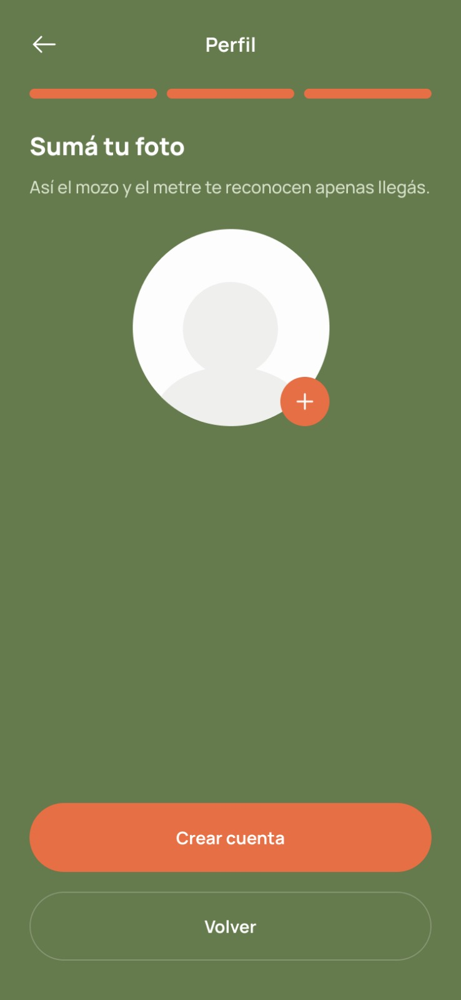
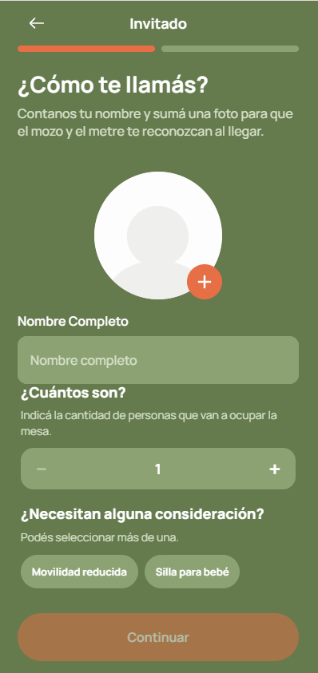
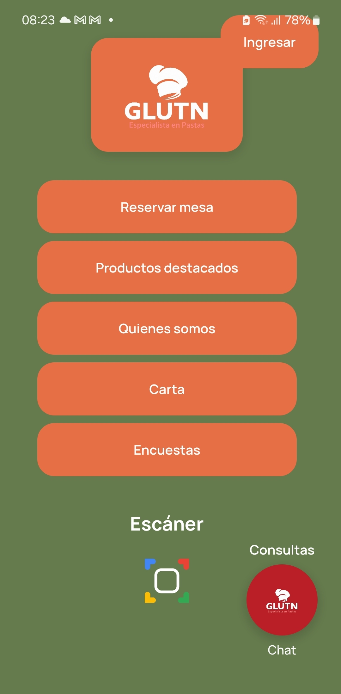
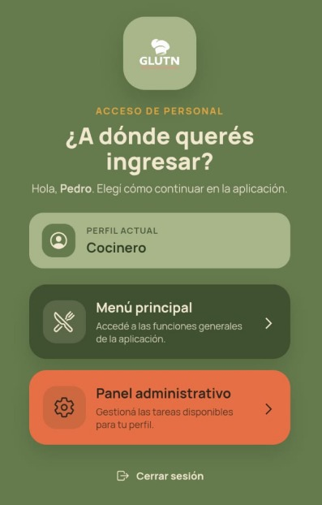
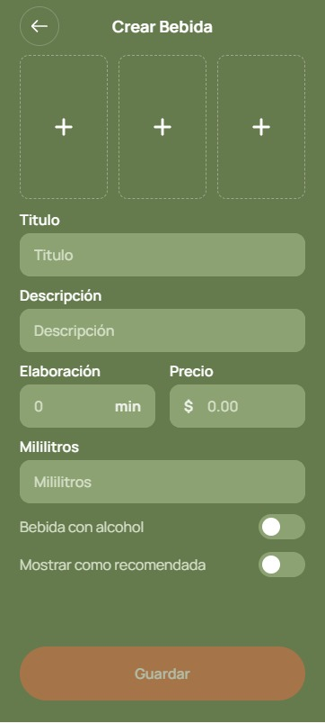

# GLUTN - Especialista en Pastas 

## Trabajo Final Integrador - 2026

## 🖼️ Logo del proyecto

  

---

## 📸 Capturas de la aplicación

### Splash Screen

  

---
### Login

  

---
### Registro de clientes

  

  

  

---
### Registro de invitados

  

  

---
### Menú principal

  

---
### Panel administrativo

  

---
### Administración de bebidas

  

  

  

  

---

Aplicación móvil desarrollada como Trabajo Final Integrador de la Tecnicatura Universitaria en Programación de la Universidad Tecnológica Nacional - Facultad Regional Avellaneda.

Esta aplicación esta orientada a la gestión integral de un restaurante, permitiendo administrar diferentes perfiles de usuarios, el ingreso de clientes, la asignación de mesas, la gestión de pedido y la comunicación entre los distintos sectores del restaurante. 

---

# 1. 👥 Integrantes

- **Joaquín Felipe Díaz**
- **Javier Francisco Vilchez**
- **Lucas Nicolás Ponte**
- **Mariano Pastor**

---

# 2. 🛠️ Stack tecnológico utilizado 

El proyecto fue desarrollado utilizando:

- Ionic
- Angular
- Capacitor
- Supabase
- SCSS
- HTML

Además, se utilizan funcionalidades nativas de los dispositivos móviles, como:

- Cámara
- Escaneo de códigos
- Vibraciones
- Sonidos
- Notificaciones
- Lectura de códigos QR

---

# 3. 📱 Funcionalidades del proyecto

La aplicación contempla los siguientes puntos funcionales establecidos para el Trabajo Final Integrador:

1. Agregar empleado.
2. Agregar plato.
3. Agregar bebida.
4. Agregar mesa.
5. Crear cliente registrado.
6. Verificar ingreso del cliente registrado.
7. Rechazar cliente registrado.
8. Aceptar cliente registrado.
9. Ingreso de cliente anónimo y lista de espera.
10. Asignación de mesa.
11. Visualización del menú y consulta al mozo.
12. Realización del pedido.
13. Rechazo del pedido.
14. Confirmación del pedido.
15. Juegos.
16. Sector cocina recibe los productos.
17. Sector bar recibe los productos.
18. Cocina y bar informan que el pedido está listo.
19. Entrega del pedido.
20. Encuestas y gráficos.
21. Solicitud de cuenta y pago.
22. Confirmación del pago y liberación de mesa.

---

# 4. 📋 Distribución de responsabilidades

Cada integrante cuenta con funcionalidades principales asignadas. Esta división representa la responsabilidad principal sobre cada módulo.

> **Aclaración:** La distribución de responsabilidades y módulos puede estar sujeta a cambios a medida que avance el desarrollo del proyecto. Algunas funcionalidades pueden requerir la integración y colaboración de más de un integrante, especialmente cuando un módulo dependa de funcionalidades desarrolladas por otros participantes. En esos casos, aunque exista un responsable principal asignado, podrán participar otros integrantes del equipo para completar su implementación e integración.

| Integrante | Puntos asignados |
|---|---|
| **Joaquín Díaz** | 1, 5, 6, 7, 8 y 20 |
| **Javier Vilchez** | 3, 4, 9, 10, 17 y 22 |
| **Lucas Ponte** | 11, 12, 13, 14 y 21 |
| **Mariano Pastor** | 2, 15, 16, 18 y 19 |

---

## 👤 Joaquín Díaz

### Puntos asignados

- **1. Agregar empleado**
- **5. Crear cliente registrado**
- **6. Verificar ingreso del cliente registrado**
- **7. Rechazar cliente registrado**
- **8. Aceptar cliente registrado**
- **20. Encuestas y gráficos**

### Responsabilidades principales

- Gestión de empleados.
- Registro de clientes.
- Validaciones de formularios.
- Gestión de usuarios registrados.
- Aprobación y rechazo de solicitudes de registro.
- Integración de autenticación.
- Gestión de información en la base de datos.
- Implementación de encuestas.
- Visualización de resultados mediante gráficos.

---

## 👤 Javier Vilchez

### Puntos asignados

- **3. Agregar bebida**
- **4. Agregar mesa**
- **9. Ingreso de cliente anónimo y lista de espera**
- **10. Asignación de mesa**
- **17. Sector bar recibe los productos**
- **22. Confirmación del pago y liberación de mesa**

### Responsabilidades principales

- Gestión de bebidas.
- Gestión de mesas.
- Generación y administración de códigos correspondientes a las mesas.
- Ingreso de clientes anónimos.
- Gestión de la lista de espera.
- Asignación de mesas.
- Gestión de pedidos correspondientes al sector bar.
- Confirmación del pago.
- Liberación de mesas luego de finalizar la experiencia del cliente.

---

## 👤 Lucas Ponte

### Puntos asignados

- **12. Realización del pedido**
- **13. Rechazo del pedido**
- **14. Confirmación del pedido**
- **19. Entrega del pedido**
- **21. Solicitud de cuenta y pago**

### Responsabilidades principales
- Consulta de productos.
- Comunicación entre clientes y mozos.
- Gestión de pedidos.
- Confirmación y rechazo de pedidos.
- Solicitud de cuenta.
- Cálculo del importe final.
- Gestión de descuentos.
- Gestión de propinas.
- Entrega del pedido.
- Implementación del proceso de pago simulado.

---

## 👤 Mariano Pastor

### Puntos asignados

- **2. Agregar plato**
- **11. Visualización del menú y consulta al mozo**
- **15. Juegos**
- **16. Sector cocina recibe los productos**
- **18. Cocina y bar informan que el pedido está listo**

### Responsabilidades principales
- Visualización del menú.
- Gestión de platos.
- Implementación de juegos para los clientes.
- Gestión de pedidos correspondientes al sector cocina.
- Actualización del estado de preparación de los pedidos.
- Notificación de productos terminados.
- Gestión de la entrega de pedidos al cliente.

---

# 5. 📊 Avances del proyecto

| Tarea | Responsable | Inicio | Finalización | Estado | Rama |
|---|---|---|---|---|---|
| Logo | Mariano Pastor | 23/08/2026 | 24/08/2026 | A la espera de corrección | Joaquin-Diaz |
| Splash Screen | Joaquín Díaz | 23/08/2026 | 24/08/2026 | A la espera de corrección | Joaquin-Diaz |
| Registro de usuarios | Javier Vilchez | 24/08/2026 | 28/08/2026 | A la espera de corrección | Javier-Vilchez |
| Login de usuarios registrados y personal | Lucas Ponte | 25/08/2026 | 03/09/2026 | A la espera de correción | Lucas-Ponte |
| Diseño del menú principal | Mariano Pastor | 25/08/2026 | - | En curso | Mariano-Pastor |
| Diseño del panel administrativo | Joaquín Díaz | 01/09/2026 | 03/09/2026 | A la espera de correción | Joaquin-Diaz |
| Diseño de administración de bebidas | Javier Vilchez | 04/09/2026 | 04/09/2026 | A la espera de correción | Javier-Vilchez |
| Diseño de login de invitados | Javier Vilchez | 04/09/2026 | 04/09/2026 | A la espera de correción | Javier-Vilchez |

